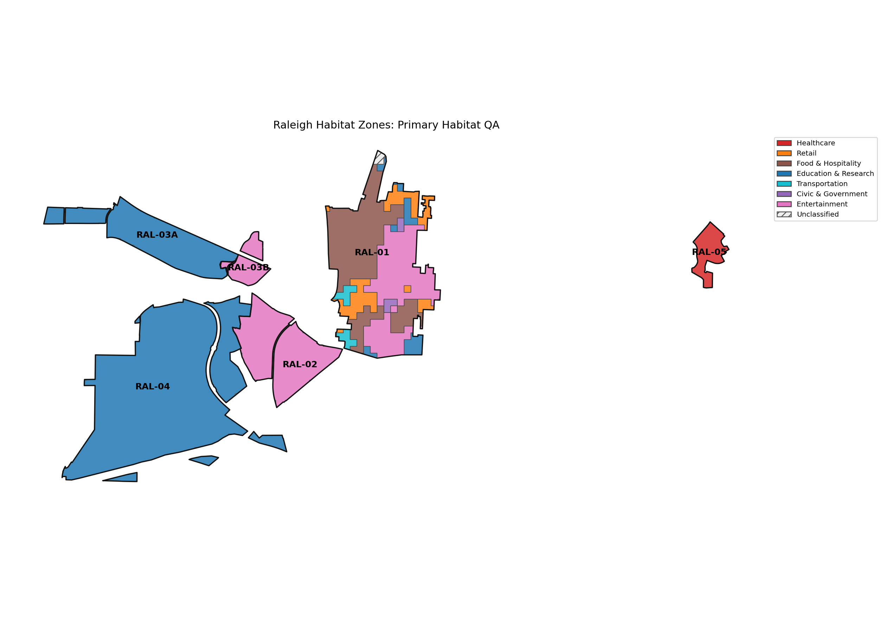
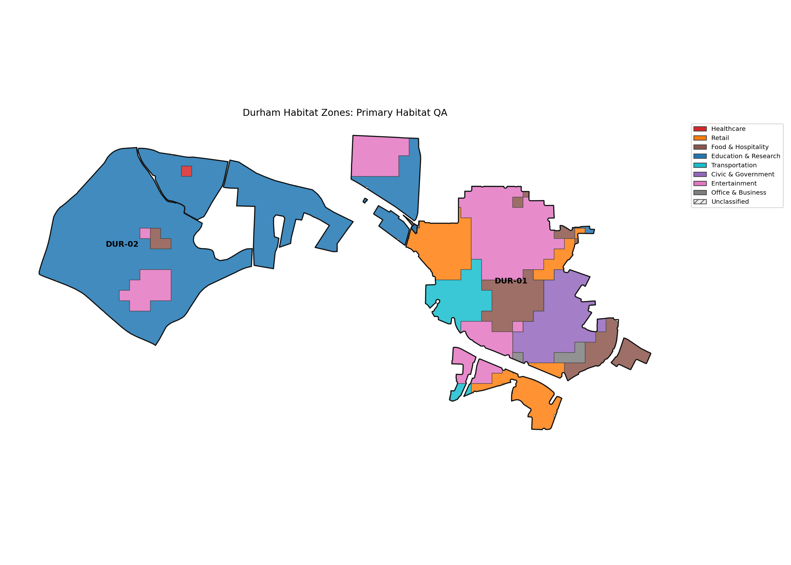
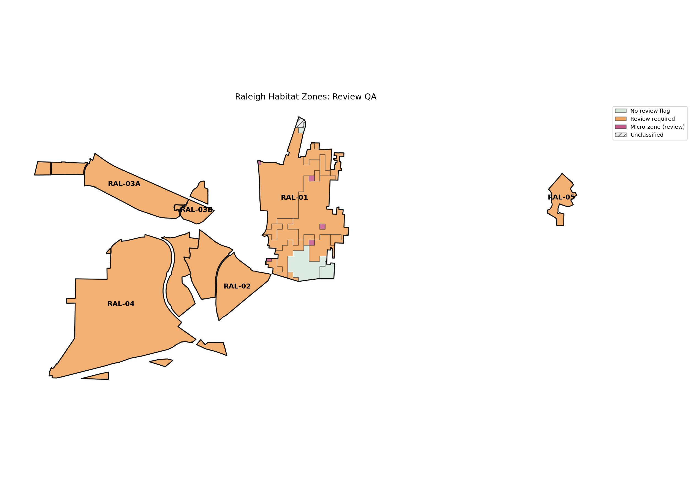
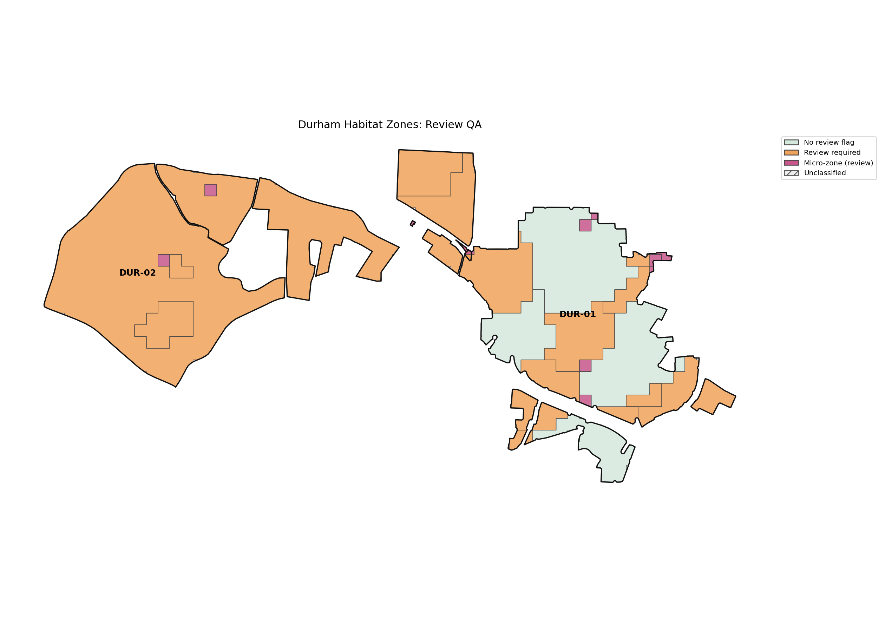

# Step 7B Habitat Zone QA

Total habitat zones: 62.
Micro-zones: 18; review required: 55.
All 1,993 classified cells and all 5 neutral cells have exactly one membership. Cell inputs are unchanged.

## Zones and Area by Habitat

| habitat_primary | zones | area_acres |
| --- | --- | --- |
| Healthcare | 2 | 67.2672 |
| Finance | 0 | 0.0000 |
| Retail | 12 | 246.2323 |
| Food & Hospitality | 11 | 448.6431 |
| Education & Research | 15 | 2165.7128 |
| Transportation | 4 | 90.9202 |
| Civic & Government | 3 | 120.2486 |
| Entertainment | 13 | 930.6368 |
| Office & Business | 2 | 11.9173 |

## Region Breakdowns

### DUR-01

Zones: 22. Neutral area: 0.000000 acres.

| habitat_primary | zones | cells | area_acres |
| --- | --- | --- | --- |
| Civic & Government | 1 | 50 | 107.8933 |
| Education & Research | 1 | 3 | 1.4707 |
| Entertainment | 4 | 97 | 206.3799 |
| Food & Hospitality | 7 | 60 | 111.4468 |
| Office & Business | 2 | 5 | 11.9173 |
| Retail | 5 | 77 | 139.8544 |
| Transportation | 2 | 34 | 66.2524 |

### DUR-02

Zones: 8. Neutral area: 0.000000 acres.

| habitat_primary | zones | cells | area_acres |
| --- | --- | --- | --- |
| Education & Research | 3 | 348 | 704.7008 |
| Entertainment | 3 | 37 | 84.3447 |
| Food & Hospitality | 1 | 3 | 7.4132 |
| Healthcare | 1 | 1 | 2.4711 |

### RAL-01

Zones: 24. Neutral area: 6.010529 acres.

| habitat_primary | zones | cells | area_acres |
| --- | --- | --- | --- |
| Civic & Government | 2 | 5 | 12.3553 |
| Education & Research | 6 | 26 | 43.8123 |
| Entertainment | 4 | 118 | 266.4537 |
| Food & Hospitality | 3 | 152 | 329.7831 |
| Retail | 7 | 57 | 106.3779 |
| Transportation | 2 | 13 | 24.6678 |

### RAL-02

Zones: 1. Neutral area: 0.000000 acres.

| habitat_primary | zones | cells | area_acres |
| --- | --- | --- | --- |
| Entertainment | 1 | 151 | 307.4545 |

### RAL-03A

Zones: 1. Neutral area: 0.000000 acres.

| habitat_primary | zones | cells | area_acres |
| --- | --- | --- | --- |
| Education & Research | 1 | 151 | 300.0000 |

### RAL-03B

Zones: 1. Neutral area: 0.000000 acres.

| habitat_primary | zones | cells | area_acres |
| --- | --- | --- | --- |
| Entertainment | 1 | 41 | 66.0041 |

### RAL-04

Zones: 4. Neutral area: 0.000000 acres.

| habitat_primary | zones | cells | area_acres |
| --- | --- | --- | --- |
| Education & Research | 4 | 525 | 1115.7291 |

### RAL-05

Zones: 1. Neutral area: 0.000000 acres.

| habitat_primary | zones | cells | area_acres |
| --- | --- | --- | --- |
| Healthcare | 1 | 39 | 64.7961 |

## Largest Zone per Region

| zone_id | cell_count | area_acres |
| --- | --- | --- |
| DUR-01_entertainment_8b8260cfa788 | 67 | 157.0535 |
| DUR-02_education_research_a66bdec3bcfe | 309 | 637.5316 |
| RAL-01_food_hospitality_033b442ed17e | 118 | 253.3036 |
| RAL-02_entertainment_2d1b2b7ec190 | 151 | 307.4545 |
| RAL-03A_education_research_b86247e5f553 | 151 | 300.0000 |
| RAL-03B_entertainment_23ac1adbb497 | 41 | 66.0041 |
| RAL-04_education_research_896468efaa47 | 495 | 1080.2445 |
| RAL-05_healthcare_1ce0f916b48d | 39 | 64.7961 |

## Smallest Five Zones

| zone_id | cell_count | area_acres | review_reasons |
| --- | --- | --- | --- |
| RAL-01_retail_8b022d734782 | 1 | 0.1732 | ["micro_zone", "low_confidence_area_over_30pct"] |
| DUR-02_education_research_ebfff1e1cd7a | 1 | 0.2455 | ["micro_zone"] |
| RAL-01_entertainment_be0ed8a3968d | 1 | 0.3078 | ["micro_zone", "low_confidence_area_over_30pct"] |
| DUR-01_food_hospitality_6ee7a6b93f5b | 1 | 0.3968 | ["micro_zone", "low_confidence_area_over_30pct"] |
| DUR-01_food_hospitality_544e0ead1d32 | 1 | 0.7623 | ["micro_zone", "low_confidence_area_over_30pct"] |

## Zones with More Than 30% Low-confidence Area

| zone_id | cell_count | area_acres | low_confidence_area_pct |
| --- | --- | --- | --- |
| DUR-01_entertainment_34b05b968a30 | 1 | 2.4711 | 100.0000 |
| DUR-01_entertainment_734cbcf0afe2 | 14 | 25.5115 | 38.6700 |
| DUR-01_food_hospitality_087fabf25c8a | 3 | 4.6500 | 100.0000 |
| DUR-01_food_hospitality_0a26c06e2b5e | 24 | 59.3053 | 45.8333 |
| DUR-01_food_hospitality_544e0ead1d32 | 1 | 0.7623 | 100.0000 |
| DUR-01_food_hospitality_66c4fc30d17a | 1 | 0.9082 | 100.0000 |
| DUR-01_food_hospitality_6ee7a6b93f5b | 1 | 0.3968 | 100.0000 |
| DUR-01_food_hospitality_cbb9149c0bea | 1 | 2.4711 | 100.0000 |
| DUR-01_office_business_2c7bbe97ac8b | 4 | 9.8842 | 50.0000 |
| DUR-01_retail_3d47cad6561f | 8 | 16.7859 | 71.1153 |
| DUR-01_retail_476a65ddf968 | 1 | 1.6180 | 100.0000 |
| DUR-01_transportation_f3f565242664 | 4 | 4.5957 | 61.3715 |
| DUR-02_entertainment_42185cd162db | 14 | 34.5948 | 35.7143 |
| DUR-02_entertainment_a1422610b386 | 1 | 2.4711 | 100.0000 |
| DUR-02_food_hospitality_b36803caa431 | 3 | 7.4132 | 100.0000 |
| DUR-02_healthcare_2627c03f3acf | 1 | 2.4711 | 100.0000 |
| RAL-01_civic_government_4122c920455f | 2 | 4.9421 | 50.0000 |
| RAL-01_civic_government_55645bdf1721 | 3 | 7.4132 | 100.0000 |
| RAL-01_education_research_1b5872a3ba8a | 3 | 4.7197 | 31.7686 |
| RAL-01_education_research_471c242582fb | 5 | 12.3553 | 60.0000 |
| RAL-01_education_research_a383be9551c7 | 1 | 2.4711 | 100.0000 |
| RAL-01_education_research_d285af14e9d1 | 3 | 2.8973 | 89.1557 |
| RAL-01_entertainment_4c4a7b120213 | 84 | 191.3911 | 30.0419 |
| RAL-01_entertainment_a724837c2960 | 1 | 2.4711 | 100.0000 |
| RAL-01_entertainment_be0ed8a3968d | 1 | 0.3078 | 100.0000 |
| RAL-01_food_hospitality_5a3371deb839 | 17 | 37.5807 | 54.5249 |
| RAL-01_food_hospitality_9c731508ac79 | 17 | 38.8988 | 46.0238 |
| RAL-01_retail_1003b8ba79e9 | 22 | 48.0352 | 74.8105 |
| RAL-01_retail_3b1643073e76 | 1 | 2.4711 | 100.0000 |
| RAL-01_retail_3e5bb79c883d | 1 | 1.1035 | 100.0000 |
| RAL-01_retail_8b022d734782 | 1 | 0.1732 | 100.0000 |
| RAL-01_retail_c48bd7907bfb | 26 | 44.0920 | 35.1587 |
| RAL-01_retail_c5e11704edf4 | 5 | 9.2220 | 51.3528 |
| RAL-01_transportation_9d869af1ecf9 | 6 | 13.0920 | 43.3763 |
| RAL-01_transportation_b87768a33a27 | 7 | 11.5758 | 50.1969 |

## Dominant Secondary Counts

| habitat | zones |
| --- | --- |
| (none) | 22 |
| Entertainment | 10 |
| Food & Hospitality | 9 |
| Education & Research | 8 |
| Retail | 6 |
| Civic & Government | 5 |
| Office & Business | 1 |
| Transportation | 1 |

## Coverage

| region_id | retained_cell_area_sqft | zone_plus_neutral_area_sqft | coverage_difference_sqft | symmetric_difference_sqft |
| --- | --- | --- | --- | --- |
| DUR-01 | 28105557.0769 | 28105557.0769 | 0.0000 | 0.0000 |
| DUR-02 | 34801378.1124 | 34801378.1124 | 0.0000 | 0.0000 |
| RAL-01 | 34388899.5976 | 34388899.5976 | -0.0000 | 0.0000 |
| RAL-02 | 13392716.3348 | 13392716.3348 | 0.0000 | 0.0000 |
| RAL-03A | 13067999.6448 | 13067999.6448 | 0.0000 | 0.0000 |
| RAL-03B | 2875140.5552 | 2875140.5552 | -0.0000 | 0.0000 |
| RAL-04 | 48601157.4691 | 48601157.4691 | -0.0000 | 0.0000 |
| RAL-05 | 2822518.5194 | 2822518.5194 | -0.0000 | 0.0000 |

Coverage uses retained cell area, not full region area. No unexplained coverage differences exceed the numerical tolerance.

## Geometry Review

Exact unions with multiple polygon parts: 11; source metadata inconsistencies: 19.
MultiPolygon source cells remain atomic membership units. Their disconnected fragments remain disconnected in exact zone geometry and are flagged for review.

## Inherited Cross-region Overlaps

| zone_id_a | zone_id_b | region_id_a | region_id_b | overlap_area_sqft | overlap_area_acres | inherited_source_overlap_sqft | introduced_overlap_sqft | cross_region |
| --- | --- | --- | --- | --- | --- | --- | --- | --- |
| DUR-01_food_hospitality_66c4fc30d17a | DUR-02_education_research_8e27edf48ee5 | DUR-01 | DUR-02 | 16653.6089 | 0.3823 | 16653.6089 | 0.0000 | True |
| DUR-01_retail_8355c45da0b9 | DUR-02_education_research_8e27edf48ee5 | DUR-01 | DUR-02 | 18900.4263 | 0.4339 | 18900.4263 | 0.0000 | True |
| RAL-02_entertainment_2d1b2b7ec190 | RAL-04_education_research_896468efaa47 | RAL-02 | RAL-04 | 3660.8629 | 0.0840 | 3660.8629 | 0.0000 | True |
| RAL-03A_education_research_b86247e5f553 | RAL-03B_entertainment_23ac1adbb497 | RAL-03A | RAL-03B | 16193.2438 | 0.3717 | 16193.2438 | 0.0000 | True |

These overlaps exist in canonical cells. No overlap was introduced by the dissolve. Coverage is accounted per region.

## Input SHA-256

{
  "data/processed/habitat_cells.geojson": "ea60a2d9f89ac25bb35543913ec3d2258ff902918b0687ca26ad608935967146",
  "data/processed/habitat_cells.csv": "2b202fed12ed43e6fe08258c0fefba6091cbec9d297c752b63c060d267568583",
  "data/processed/regions.geojson": "578a5358e47b365e4bd8cde306f2ff43ff596ad951890aa7ed8c57aa398efbe3",
  "data/config/habitat_spatial_config.yaml": "46706dcd29b8c735d070d90527f15c3664cfaac2abf17e39ca00961a03306511"
}

## Maps

