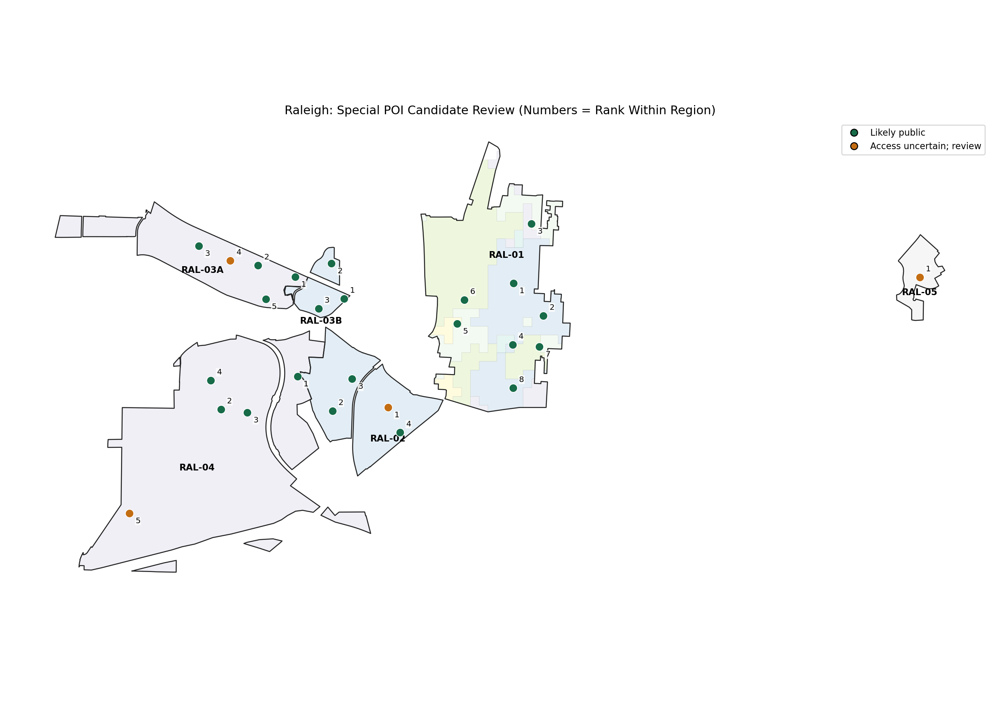
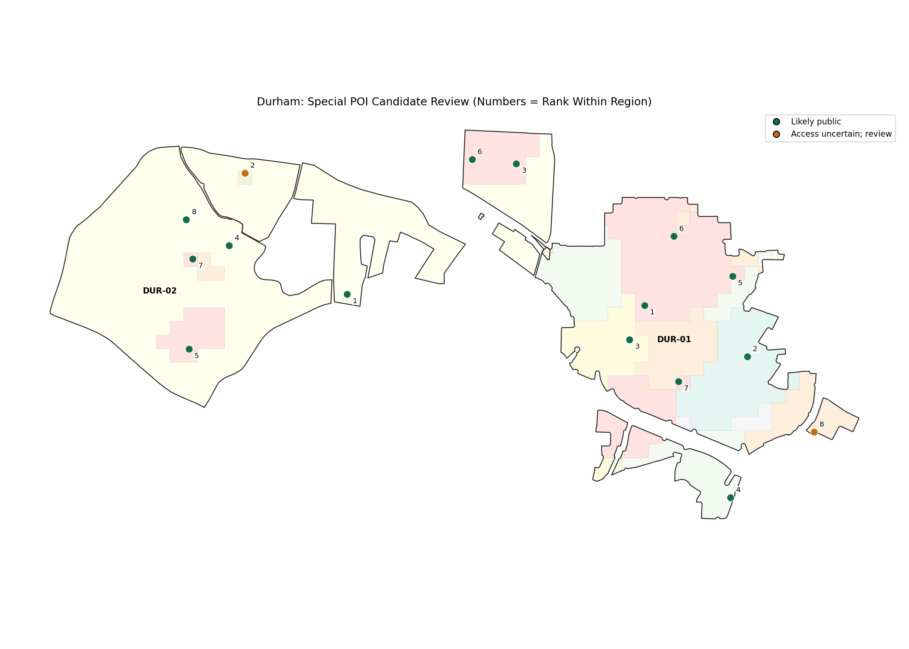

# Special POI Candidate Review

Candidates for human review only. No final special locations or rarity pools are assigned.

Evaluated: 927; eligible: 824; excluded: 103; review queue: 103.

## Exclusion Reasons

{
  "habitat_classification_requires_review": 58,
  "restricted_or_inappropriate": 13,
  "missing_meaningful_name": 33,
  "missing_primary_habitat": 47
}

## Access Status

| status | count |
| --- | --- |
| likely_public | 582 |
| public_context_access_uncertain | 332 |
| restricted_or_inappropriate | 13 |

## Regional Summary

| region_id | parent_city | total_pois | eligible_candidate_pois | excluded_pois | access_uncertain_candidates | quality_threshold_candidates | shortlist_size | shortlist_habitat_distribution | shortlist_average_raw_score | spacing_preference_unmet_count | unshortlisted_strong_spacing_conflicts | weak_candidate_coverage |
| --- | --- | --- | --- | --- | --- | --- | --- | --- | --- | --- | --- | --- |
| DUR-01 | Durham | 264 | 230 | 34 | 76 | 56 | 8 | {"Civic & Government": 1, "Education & Research": 2, "Entertainment": 4, "Transportation": 1} | 79.20 | 0 | 26 | False |
| DUR-02 | Durham | 82 | 69 | 13 | 16 | 40 | 8 | {"Education & Research": 2, "Entertainment": 5, "Healthcare": 1} | 75.79 | 0 | 27 | False |
| RAL-01 | Raleigh | 470 | 427 | 43 | 148 | 93 | 8 | {"Civic & Government": 1, "Education & Research": 2, "Entertainment": 4, "Transportation": 1} | 83.74 | 0 | 58 | False |
| RAL-02 | Raleigh | 24 | 22 | 2 | 5 | 7 | 4 | {"Civic & Government": 1, "Entertainment": 3} | 61.90 | 0 | 3 | False |
| RAL-03A | Raleigh | 38 | 38 | 0 | 12 | 17 | 5 | {"Entertainment": 4, "Healthcare": 1} | 70.40 | 0 | 12 | False |
| RAL-03B | Raleigh | 9 | 8 | 1 | 1 | 4 | 3 | {"Civic & Government": 1, "Entertainment": 2} | 64.96 | 0 | 1 | False |
| RAL-04 | Raleigh | 37 | 27 | 10 | 8 | 14 | 5 | {"Civic & Government": 1, "Education & Research": 2, "Entertainment": 2} | 70.77 | 0 | 8 | False |
| RAL-05 | Raleigh | 3 | 3 | 0 | 3 | 1 | 1 | {"Healthcare": 1} | 55.00 | 0 | 0 | True |

## DUR-01

| region_candidate_rank | name | habitat_primary | habitat_secondary | raw_candidate_score | candidate_access_status | nearest_selected_candidate_distance_m | recommendation_rationale |
| --- | --- | --- | --- | --- | --- | --- | --- |
| 1 | The History Hub Museum | Entertainment | Education & Research | 86.84 | likely_public | 271.26 | Museum educational environment; primary habitat is 17% of regional POIs. Public-facing cultural, outdoor, educational, or transit function is a proxy, not an access guarantee. Human-review candidate only. |
| 2 | Durham County Library - Main Library | Education & Research | Civic & Government | 86.39 | likely_public | 536.18 | Library educational resources; primary habitat is 4% of regional POIs. Public-facing cultural, outdoor, educational, or transit function is a proxy, not an access guarantee. Human-review candidate only. |
| 3 | Durham Station | Transportation |  | 77.67 | likely_public | 271.26 | Explicit station or bus-station facility context; primary habitat is 3% of regional POIs. Public-facing cultural, outdoor, educational, or transit function is a proxy, not an access guarantee. Human-review candidate only. |
| 4 | St. Joseph's Historic Foundation Hayti Heritage Center | Entertainment | Education & Research | 79.84 | likely_public | 775.28 | Cultural or event destination; primary habitat is 17% of regional POIs. Public-facing cultural, outdoor, educational, or transit function is a proxy, not an access guarantee. Human-review candidate only. |
| 5 | LGBTQ Center of Durham | Civic & Government | Entertainment | 76.14 | likely_public | 520.15 | Community gathering environment; primary habitat is 3% of regional POIs. Public-facing cultural, outdoor, educational, or transit function is a proxy, not an access guarantee. Human-review candidate only. |
| 6 | Durham Athletic Park | Entertainment |  | 79.06 | likely_public | 520.15 | Substantial athletic destination; primary habitat is 17% of regional POIs. Explicit public/permissive access tag; association anchor still needs human review. Human-review candidate only. |
| 7 | Durham Performing Arts Center | Entertainment |  | 74.06 | likely_public | 471.01 | Cultural or event destination; primary habitat is 17% of regional POIs. Public-facing cultural, outdoor, educational, or transit function is a proxy, not an access guarantee. Human-review candidate only. |
| 8 | Shodor | Education & Research |  | 73.60 | public_context_access_uncertain | 735.55 | Explicit research function; primary habitat is 4% of regional POIs. Office/research/trade function does not establish public access. Human-review candidate only. |

## DUR-02

| region_candidate_rank | name | habitat_primary | habitat_secondary | raw_candidate_score | candidate_access_status | nearest_selected_candidate_distance_m | recommendation_rationale |
| --- | --- | --- | --- | --- | --- | --- | --- |
| 1 | Nasher Museum of Art | Entertainment | Education & Research | 89.36 | likely_public | 933.43 | Museum educational environment; primary habitat is 51% of regional POIs. Public-facing cultural, outdoor, educational, or transit function is a proxy, not an access guarantee. Human-review candidate only. |
| 2 | Duke University Hospital | Healthcare |  | 77.99 | public_context_access_uncertain | 540.18 | Hospital environment; primary habitat is 10% of regional POIs. Healthcare association may be useful, but the anchor may represent clinical or patient space. Human-review candidate only. |
| 3 | Lilly Library | Education & Research | Civic & Government | 77.02 | likely_public | 324.72 | Library educational resources; primary habitat is 9% of regional POIs. Public-facing cultural, outdoor, educational, or transit function is a proxy, not an access guarantee. Human-review candidate only. |
| 4 | Perkins Library | Education & Research | Civic & Government | 77.02 | likely_public | 283.54 | Library educational resources; primary habitat is 9% of regional POIs. Public-facing cultural, outdoor, educational, or transit function is a proxy, not an access guarantee. Human-review candidate only. |
| 5 | Wallace Wade Stadium | Entertainment |  | 71.82 | likely_public | 659.25 | Substantial athletic destination; primary habitat is 51% of regional POIs. Public-facing event/recreation context; tickets or opening hours may limit access. Human-review candidate only. |
| 6 | Jack Katz Stadium | Entertainment |  | 71.82 | likely_public | 324.72 | Substantial athletic destination; primary habitat is 51% of regional POIs. Public-facing event/recreation context; tickets or opening hours may limit access. Human-review candidate only. |
| 7 | R.J. Reynolds Industries Theater | Entertainment |  | 70.82 | likely_public | 283.54 | Cultural or event destination; primary habitat is 51% of regional POIs. Public-facing cultural, outdoor, educational, or transit function is a proxy, not an access guarantee. Human-review candidate only. |
| 8 | Putman quad | Entertainment | Civic & Government | 70.44 | likely_public | 289.85 | Outdoor environmental context; primary habitat is 51% of regional POIs. Public-facing cultural, outdoor, educational, or transit function is a proxy, not an access guarantee. Human-review candidate only. |

## RAL-01

| region_candidate_rank | name | habitat_primary | habitat_secondary | raw_candidate_score | candidate_access_status | nearest_selected_candidate_distance_m | recommendation_rationale |
| --- | --- | --- | --- | --- | --- | --- | --- |
| 1 | North Carolina Museum of Natural Sciences | Entertainment | Education & Research | 91.01 | likely_public | 501.48 | Museum educational environment; primary habitat is 14% of regional POIs. Public-facing cultural, outdoor, educational, or transit function is a proxy, not an access guarantee. Human-review candidate only. |
| 2 | Marbles Kids Museum | Entertainment | Education & Research | 91.01 | likely_public | 360.21 | Museum educational environment; primary habitat is 14% of regional POIs. Public-facing cultural, outdoor, educational, or transit function is a proxy, not an access guarantee. Human-review candidate only. |
| 3 | Finch Library | Education & Research | Civic & Government | 85.97 | likely_public | 712.48 | Library educational resources; primary habitat is 2% of regional POIs. Public-facing cultural, outdoor, educational, or transit function is a proxy, not an access guarantee. Human-review candidate only. |
| 4 | Express Library Fayetteville Street | Education & Research | Civic & Government | 85.97 | likely_public | 306.54 | Library educational resources; primary habitat is 2% of regional POIs. Public-facing cultural, outdoor, educational, or transit function is a proxy, not an access guarantee. Human-review candidate only. |
| 5 | Raleigh Union Station Bus Facility | Transportation |  | 78.28 | likely_public | 282.71 | Explicit station or bus-station facility context; primary habitat is 4% of regional POIs. Public-facing cultural, outdoor, educational, or transit function is a proxy, not an access guarantee. Human-review candidate only. |
| 6 | RUMAH | Civic & Government | Entertainment | 77.66 | likely_public | 282.71 | Community gathering environment; primary habitat is 5% of regional POIs. Public-facing cultural, outdoor, educational, or transit function is a proxy, not an access guarantee. Human-review candidate only. |
| 7 | Artspace | Entertainment | Education & Research | 80.01 | likely_public | 306.54 | Cultural or event destination; primary habitat is 14% of regional POIs. Public-facing cultural, outdoor, educational, or transit function is a proxy, not an access guarantee. Human-review candidate only. |
| 8 | Betty Ray McCain Art Gallery | Entertainment | Education & Research | 80.01 | likely_public | 491.48 | Cultural or event destination; primary habitat is 14% of regional POIs. Public-facing cultural, outdoor, educational, or transit function is a proxy, not an access guarantee. Human-review candidate only. |

## RAL-02

| region_candidate_rank | name | habitat_primary | habitat_secondary | raw_candidate_score | candidate_access_status | nearest_selected_candidate_distance_m | recommendation_rationale |
| --- | --- | --- | --- | --- | --- | --- | --- |
| 1 | NC Department of Health and Human Services Social Services | Civic & Government | Office & Business | 69.71 | public_context_access_uncertain | 316.86 | Civic or public-safety function; access separately reviewed; primary habitat is 8% of regional POIs. Office/research/trade function does not establish public access. Human-review candidate only. |
| 2 | Big Field | Entertainment | Civic & Government | 59.29 | likely_public | 427.71 | Outdoor environmental context; primary habitat is 67% of regional POIs. Public-facing cultural, outdoor, educational, or transit function is a proxy, not an access guarantee. Human-review candidate only. |
| 3 | Sunflower Field | Entertainment | Civic & Government | 59.29 | likely_public | 427.71 | Outdoor environmental context; primary habitat is 67% of regional POIs. Public-facing cultural, outdoor, educational, or transit function is a proxy, not an access guarantee. Human-review candidate only. |
| 4 | Gipson Play Plaza | Entertainment | Civic & Government | 59.29 | likely_public | 316.86 | Outdoor environmental context; primary habitat is 67% of regional POIs. Public-facing cultural, outdoor, educational, or transit function is a proxy, not an access guarantee. Human-review candidate only. |

## RAL-03A

| region_candidate_rank | name | habitat_primary | habitat_secondary | raw_candidate_score | candidate_access_status | nearest_selected_candidate_distance_m | recommendation_rationale |
| --- | --- | --- | --- | --- | --- | --- | --- |
| 1 | NC State Crafts Center | Entertainment | Education & Research | 77.21 | likely_public | 420.83 | Cultural or event destination; primary habitat is 68% of regional POIs. Public-facing cultural, outdoor, educational, or transit function is a proxy, not an access guarantee. Human-review candidate only. |
| 2 | Price Music Center | Entertainment | Education & Research | 77.21 | likely_public | 321.73 | Cultural or event destination; primary habitat is 68% of regional POIs. Public-facing cultural, outdoor, educational, or transit function is a proxy, not an access guarantee. Human-review candidate only. |
| 3 | SOL Garden | Entertainment | Civic & Government | 69.68 | likely_public | 395.34 | Outdoor environmental context; primary habitat is 68% of regional POIs. Public-facing cultural, outdoor, educational, or transit function is a proxy, not an access guarantee. Human-review candidate only. |
| 4 | Student Health Center | Healthcare |  | 64.74 | public_context_access_uncertain | 321.73 | Specialized care function; access separately reviewed; primary habitat is 3% of regional POIs. Healthcare association may be useful, but the anchor may represent clinical or patient space. Human-review candidate only. |
| 5 | Weisiger Brown Athletic Facility | Entertainment |  | 63.16 | likely_public | 393.74 | Event or structured recreation environment; primary habitat is 68% of regional POIs. Public-facing event/recreation context; tickets or opening hours may limit access. Human-review candidate only. |

## RAL-03B

| region_candidate_rank | name | habitat_primary | habitat_secondary | raw_candidate_score | candidate_access_status | nearest_selected_candidate_distance_m | recommendation_rationale |
| --- | --- | --- | --- | --- | --- | --- | --- |
| 1 | Pullen Community Center | Civic & Government | Entertainment | 74.22 | likely_public | 313.27 | Community gathering environment; primary habitat is 11% of regional POIs. Public-facing cultural, outdoor, educational, or transit function is a proxy, not an access guarantee. Human-review candidate only. |
| 2 | Theater In The Park | Entertainment |  | 60.33 | likely_public | 427.21 | Cultural or event destination; primary habitat is 67% of regional POIs. Public-facing cultural, outdoor, educational, or transit function is a proxy, not an access guarantee. Human-review candidate only. |
| 3 | Pullen Park Amusement Center | Entertainment |  | 60.33 | likely_public | 313.27 | Cultural or event destination; primary habitat is 67% of regional POIs. Public-facing cultural, outdoor, educational, or transit function is a proxy, not an access guarantee. Human-review candidate only. |

## RAL-04

| region_candidate_rank | name | habitat_primary | habitat_secondary | raw_candidate_score | candidate_access_status | nearest_selected_candidate_distance_m | recommendation_rationale |
| --- | --- | --- | --- | --- | --- | --- | --- |
| 1 | NC Japan Center | Civic & Government | Entertainment | 75.95 | likely_public | 703.93 | Community gathering environment; primary habitat is 5% of regional POIs. Public-facing cultural, outdoor, educational, or transit function is a proxy, not an access guarantee. Human-review candidate only. |
| 2 | James B. Hunt Jr. Library | Education & Research | Civic & Government | 74.05 | likely_public | 302.83 | Library educational resources; primary habitat is 24% of regional POIs. Public-facing cultural, outdoor, educational, or transit function is a proxy, not an access guarantee. Human-review candidate only. |
| 3 | The Cistern | Entertainment | Civic & Government | 70.65 | likely_public | 302.83 | Outdoor environmental context; primary habitat is 49% of regional POIs. Public-facing cultural, outdoor, educational, or transit function is a proxy, not an access guarantee. Human-review candidate only. |
| 4 | Venture Courtyard | Entertainment | Civic & Government | 70.65 | likely_public | 352.11 | Outdoor environmental context; primary habitat is 49% of regional POIs. Public-facing cultural, outdoor, educational, or transit function is a proxy, not an access guarantee. Human-review candidate only. |
| 5 | William and Ida Friday Institute for Educational Innovation | Education & Research |  | 62.57 | public_context_access_uncertain | 1577.78 | Explicit higher-education institution; primary habitat is 24% of regional POIs. University context is eligible, but public/common-space access at this anchor is unverified. Human-review candidate only. |

## RAL-05

| region_candidate_rank | name | habitat_primary | habitat_secondary | raw_candidate_score | candidate_access_status | nearest_selected_candidate_distance_m | recommendation_rationale |
| --- | --- | --- | --- | --- | --- | --- | --- |
| 1 | WakeMed Health & Hospitals: Raleigh Campus | Healthcare |  | 55.00 | public_context_access_uncertain | nan | Hospital environment; primary habitat is 100% of regional POIs. Healthcare association may be useful, but the anchor may represent clinical or patient space. Human-review candidate only. |

## Spacing Exceptions

| region_id | name | nearest_selected_candidate_distance_m | spacing_reason |
| --- | --- | --- | --- |

## Strong Unshortlisted Candidates with Spacing Conflicts

| region_id | name | raw_candidate_score | nearest_shortlisted_candidate_distance_m | shortlist_exclusion_reason |
| --- | --- | --- | --- | --- |
| DUR-01 | Durham Arts Council | 79.84 | 147.00 | region_shortlist_cap;preferred_spacing_conflict |
| DUR-01 | Durham | 77.67 | 158.67 | region_shortlist_cap;preferred_spacing_conflict |
| DUR-01 | Durham Station Transportation Center | 77.67 | 91.83 | region_shortlist_cap;preferred_spacing_conflict |
| DUR-01 | Durham | 75.67 | 199.63 | region_shortlist_cap;preferred_spacing_conflict |
| DUR-01 | Carolina Theatre | 74.06 | 191.73 | region_shortlist_cap;preferred_spacing_conflict |
| DUR-01 | Grace Garden | 71.76 | 161.89 | region_shortlist_cap;preferred_spacing_conflict |
| DUR-01 | Morris Green Park | 71.76 | 202.90 | region_shortlist_cap;preferred_spacing_conflict |
| DUR-01 | Diamond View Park | 71.76 | 103.06 | region_shortlist_cap;preferred_spacing_conflict |
| DUR-01 | Durham County Courthouse | 71.02 | 157.43 | region_shortlist_cap;preferred_spacing_conflict |
| DUR-01 | Durham City Hall | 71.02 | 245.04 | region_shortlist_cap;preferred_spacing_conflict |
| DUR-01 | Central Park | 69.76 | 204.20 | region_shortlist_cap;preferred_spacing_conflict |
| DUR-01 | Durham Bulls Athletic Park | 69.06 | 240.77 | region_shortlist_cap;preferred_spacing_conflict |
| DUR-01 | Truist | 67.70 | 208.54 | region_shortlist_cap;preferred_spacing_conflict |
| DUR-01 | Cooperativa Latina | 67.70 | 248.44 | region_shortlist_cap;preferred_spacing_conflict |
| DUR-01 | PNC Bank | 65.70 | 89.98 | region_shortlist_cap;preferred_spacing_conflict |
| DUR-01 | Motorco Music Hall | 65.06 | 224.49 | region_shortlist_cap;preferred_spacing_conflict |
| DUR-01 | The Rickhouse | 65.06 | 84.06 | region_shortlist_cap;preferred_spacing_conflict |
| DUR-01 | Bull City Veterinary Hospital | 64.85 | 152.82 | region_shortlist_cap;preferred_spacing_conflict |
| DUR-01 | Urban Tails Veterinary Hospital | 64.85 | 222.92 | region_shortlist_cap;preferred_spacing_conflict |
| DUR-01 | Crank Arm Brewing | 61.27 | 198.26 | region_shortlist_cap;preferred_spacing_conflict |
| DUR-01 | Durham Fire Station Number 1 | 61.02 | 206.16 | region_shortlist_cap;preferred_spacing_conflict |
| DUR-01 | Hi-Wire Brewing Durham | 60.27 | 210.46 | region_shortlist_cap;preferred_spacing_conflict |
| DUR-01 | The Glass Jug Beer Lab - Downtown Durham | 60.27 | 186.21 | region_shortlist_cap;preferred_spacing_conflict |
| DUR-01 | Atomic Clock Brewing Company | 60.27 | 135.60 | region_shortlist_cap;preferred_spacing_conflict |
| DUR-01 | Ment Beverage Co. | 60.27 | 189.40 | region_shortlist_cap;preferred_spacing_conflict |
| DUR-01 | Durty Bull Brewery | 60.27 | 115.03 | region_shortlist_cap;preferred_spacing_conflict |
| DUR-02 | Medical Center Library | 77.02 | 143.69 | region_shortlist_cap;subtype_cap;preferred_spacing_conflict |
| DUR-02 | Rubenstein Library | 77.02 | 51.43 | region_shortlist_cap;subtype_cap;preferred_spacing_conflict |
| DUR-02 | Bostock Library | 77.02 | 83.25 | region_shortlist_cap;subtype_cap;preferred_spacing_conflict |
| DUR-02 | Page Auditorium | 70.82 | 148.81 | region_shortlist_cap;preferred_spacing_conflict |
| DUR-02 | Sheafer Laboratory Theater | 70.82 | 36.49 | region_shortlist_cap;preferred_spacing_conflict |
| DUR-02 | Griffith Film Theater | 70.82 | 35.46 | region_shortlist_cap;preferred_spacing_conflict |
| DUR-02 | Brody Theater | 70.82 | 221.29 | region_shortlist_cap;preferred_spacing_conflict |
| DUR-02 | Baldwin Auditorium | 70.82 | 170.90 | region_shortlist_cap;preferred_spacing_conflict |
| DUR-02 | Harrington Quad | 70.44 | 176.99 | region_shortlist_cap;preferred_spacing_conflict |
| DUR-02 | LSRC Quad | 70.44 | 131.67 | region_shortlist_cap;preferred_spacing_conflict |
| DUR-02 | Medical Center Garden | 70.44 | 200.45 | region_shortlist_cap;preferred_spacing_conflict |
| DUR-02 | McGovern-Davison Children's Health Center | 67.99 | 96.21 | region_shortlist_cap;preferred_spacing_conflict |
| DUR-02 | Duke Eye Center | 67.99 | 173.95 | region_shortlist_cap;preferred_spacing_conflict |
| DUR-02 | Duke Cancer Center | 67.99 | 234.39 | region_shortlist_cap;preferred_spacing_conflict |
| DUR-02 | Duke Softball Stadium | 67.82 | 129.45 | region_shortlist_cap;subtype_cap;preferred_spacing_conflict |
| DUR-02 | Brodie Recreation Center | 65.82 | 149.22 | region_shortlist_cap;preferred_spacing_conflict |
| DUR-02 | Card Gymnasium | 65.82 | 216.59 | region_shortlist_cap;preferred_spacing_conflict |
| DUR-02 | School of Nursing | 65.33 | 190.39 | region_shortlist_cap;preferred_spacing_conflict |
| DUR-02 | Bell Medical Research Building | 63.99 | 139.07 | region_shortlist_cap;preferred_spacing_conflict |
| DUR-02 | Duke Medicine Pavillion | 63.99 | 118.22 | region_shortlist_cap;preferred_spacing_conflict |
| DUR-02 | Memorial Gym | 63.82 | 142.42 | region_shortlist_cap;preferred_spacing_conflict |
| DUR-02 | Intramural Building | 63.82 | 218.06 | region_shortlist_cap;preferred_spacing_conflict |
| DUR-02 | Wilson Recreation Center | 63.82 | 187.13 | region_shortlist_cap;preferred_spacing_conflict |
| DUR-02 | William D Murray Building | 63.82 | 134.33 | region_shortlist_cap;preferred_spacing_conflict |
| DUR-02 | Scott Family Pavilion | 63.82 | 150.68 | region_shortlist_cap;preferred_spacing_conflict |
| DUR-02 | East Campus North Quad | 62.82 | 85.84 | region_shortlist_cap;preferred_spacing_conflict |
| DUR-02 | East Campus South Quad | 62.82 | 107.05 | region_shortlist_cap;preferred_spacing_conflict |
| RAL-01 | North Carolina Museum of History | 89.01 | 96.70 | region_shortlist_cap;subtype_cap;preferred_spacing_conflict |
| RAL-01 | City of Raleigh Museum (COR Museum) | 89.01 | 201.05 | region_shortlist_cap;subtype_cap;preferred_spacing_conflict |
| RAL-01 | North Carolina Museum of Natural Sciences: Nature Research Center | 87.01 | 128.01 | region_shortlist_cap;subtype_cap;preferred_spacing_conflict |
| RAL-01 | CAM Raleigh | 87.01 | 155.74 | region_shortlist_cap;subtype_cap;preferred_spacing_conflict |
| RAL-01 | The North Carolina State Library | 85.97 | 237.77 | region_shortlist_cap;subtype_cap;preferred_spacing_conflict |
| RAL-01 | 311 Gallery | 80.01 | 245.74 | region_shortlist_cap;preferred_spacing_conflict |
| RAL-01 | Martin Marietta Center for the Performing Arts | 80.01 | 33.65 | region_shortlist_cap;preferred_spacing_conflict |
| RAL-01 | Raleigh | 78.28 | 124.89 | region_shortlist_cap;preferred_spacing_conflict |
| RAL-01 | William Peace University | 78.23 | 140.48 | region_shortlist_cap;preferred_spacing_conflict |
| RAL-01 | Raleigh | 76.28 | 208.68 | region_shortlist_cap;preferred_spacing_conflict |
| RAL-01 | GoRaleigh Station | 76.28 | 211.12 | region_shortlist_cap;preferred_spacing_conflict |
| RAL-01 | Shaw University | 76.23 | 244.66 | region_shortlist_cap;preferred_spacing_conflict |
| RAL-01 | American Underground @ Raleigh | 76.08 | 222.89 | region_shortlist_cap;preferred_spacing_conflict |
| RAL-01 | Marbles IMAX | 74.19 | 46.61 | region_shortlist_cap;preferred_spacing_conflict |
| RAL-01 | Federal Building | 73.89 | 93.45 | region_shortlist_cap;preferred_spacing_conflict |
| RAL-01 | Moore Square | 73.87 | 149.32 | region_shortlist_cap;preferred_spacing_conflict |
| RAL-01 | Messer Transmission Inc | 73.77 | 232.03 | region_shortlist_cap;preferred_spacing_conflict |
| RAL-01 | Wake County Justice Center | 72.37 | 159.75 | region_shortlist_cap;preferred_spacing_conflict |
| RAL-01 | Wake County Courthouse | 72.37 | 51.34 | region_shortlist_cap;preferred_spacing_conflict |
| RAL-01 | Raleigh Memorial Auditorium | 72.19 | 35.02 | region_shortlist_cap;preferred_spacing_conflict |
| RAL-01 | Meymandi Concert Hall | 72.19 | 53.22 | region_shortlist_cap;preferred_spacing_conflict |
| RAL-01 | Fletcher Opera Theater | 72.19 | 43.98 | region_shortlist_cap;preferred_spacing_conflict |
| RAL-01 | Kennedy Theater | 72.19 | 72.62 | region_shortlist_cap;preferred_spacing_conflict |
| RAL-01 | Memorial Auditorium | 72.19 | 16.54 | region_shortlist_cap;preferred_spacing_conflict |
| RAL-01 | Leggett Theater | 72.19 | 90.58 | region_shortlist_cap;preferred_spacing_conflict |
| RAL-01 | North Carolina Freedom Park | 71.87 | 239.45 | region_shortlist_cap;preferred_spacing_conflict |
| RAL-01 | Union Square | 71.87 | 197.42 | region_shortlist_cap;preferred_spacing_conflict |
| RAL-01 | Central Downtown Plaza | 71.87 | 166.34 | region_shortlist_cap;preferred_spacing_conflict |
| RAL-01 | PNC Plaza | 71.87 | 108.90 | region_shortlist_cap;preferred_spacing_conflict |
| RAL-01 | Edison Apartment Courtyard & Dog Park | 71.87 | 84.92 | region_shortlist_cap;preferred_spacing_conflict |
| RAL-01 | Red Hat Outdoor Terrace & Park | 71.87 | 129.86 | region_shortlist_cap;preferred_spacing_conflict |
| RAL-01 | Roofdeck Park | 71.87 | 97.56 | region_shortlist_cap;preferred_spacing_conflict |
| RAL-01 | Moriarty Construction Field Office | 70.19 | 88.83 | region_shortlist_cap;preferred_spacing_conflict |
| RAL-01 | Wake County Register of Deeds | 69.89 | 89.50 | region_shortlist_cap;preferred_spacing_conflict |
| RAL-01 | North Carolina Department of Transportation | 69.89 | 197.70 | region_shortlist_cap;preferred_spacing_conflict |
| RAL-01 | One Exchange Plaza | 69.89 | 217.24 | region_shortlist_cap;preferred_spacing_conflict |
| RAL-01 | Archdale Building | 69.89 | 212.61 | region_shortlist_cap;preferred_spacing_conflict |
| RAL-01 | Sun Sprouts | 69.87 | 11.36 | region_shortlist_cap;preferred_spacing_conflict |
| RAL-01 | BB&T | 69.70 | 168.22 | region_shortlist_cap;preferred_spacing_conflict |
| RAL-01 | North State Bank | 69.70 | 158.78 | region_shortlist_cap;preferred_spacing_conflict |
| RAL-01 | State Employees Credit Union | 69.70 | 228.27 | region_shortlist_cap;preferred_spacing_conflict |
| RAL-01 | Alcohol Rehab Raleigh | 68.79 | 200.21 | region_shortlist_cap;preferred_spacing_conflict |
| RAL-01 | Wake County Office Building | 67.89 | 22.73 | region_shortlist_cap;preferred_spacing_conflict |
| RAL-01 | Wake County Office Building | 67.89 | 19.44 | region_shortlist_cap;preferred_spacing_conflict |
| RAL-01 | Capital Bank | 67.70 | 46.32 | region_shortlist_cap;preferred_spacing_conflict |
| RAL-01 | First Citizens Bank | 67.70 | 155.48 | region_shortlist_cap;preferred_spacing_conflict |
| RAL-01 | Osprey CFO | 67.28 | 206.55 | region_shortlist_cap;preferred_spacing_conflict |
| RAL-01 | Arch Insurance - Corporate Office | 67.28 | 107.57 | region_shortlist_cap;preferred_spacing_conflict |
| RAL-01 | State Employee's Credit Union Headquarters | 67.28 | 87.58 | region_shortlist_cap;preferred_spacing_conflict |
| RAL-01 | John Montgomery Violins Inc | 65.98 | 57.07 | region_shortlist_cap;preferred_spacing_conflict |
| RAL-01 | PNC Bank | 65.70 | 102.32 | region_shortlist_cap;preferred_spacing_conflict |
| RAL-01 | Krav Maga Ralelgh | 65.19 | 150.60 | region_shortlist_cap;preferred_spacing_conflict |
| RAL-01 | Imurj | 65.19 | 236.87 | region_shortlist_cap;preferred_spacing_conflict |
| RAL-01 | CrossFit Invoke | 65.19 | 162.43 | region_shortlist_cap;preferred_spacing_conflict |
| RAL-01 | Oak Heart Veterinary Hospital | 64.79 | 230.47 | region_shortlist_cap;preferred_spacing_conflict |
| RAL-01 | Capital Club 16 | 63.81 | 143.82 | region_shortlist_cap;preferred_spacing_conflict |
| RAL-01 | Wake County Public Safety Center | 62.37 | 139.57 | region_shortlist_cap;preferred_spacing_conflict |
| RAL-01 | Young Hearts Distilling, Restaurant and Bar | 57.78 | 225.28 | region_shortlist_cap;preferred_spacing_conflict |
| RAL-02 | N. C. Department of Health and Human Services | 69.71 | 116.50 | preferred_spacing_conflict |
| RAL-02 | Melissa Nelson, LCSW | 68.58 | 29.07 | preferred_spacing_conflict |
| RAL-02 | Dorothea Dix Park | 57.29 | 200.08 | subtype_cap;preferred_spacing_conflict |
| RAL-03A | NC State University Theatre | 70.16 | 24.58 | preferred_spacing_conflict |
| RAL-03A | Thompson Hall | 70.16 | 16.77 | preferred_spacing_conflict |
| RAL-03A | Lee Field | 69.68 | 78.34 | preferred_spacing_conflict |
| RAL-03A | Wolf Plaza | 69.68 | 104.11 | preferred_spacing_conflict |
| RAL-03A | Tri-Towers Common Area | 69.68 | 161.88 | preferred_spacing_conflict |
| RAL-03A | Parents Park | 69.68 | 51.24 | preferred_spacing_conflict |
| RAL-03A | Stafford Commons | 69.68 | 88.47 | preferred_spacing_conflict |
| RAL-03A | North Carolina State University Central Campus | 63.42 | 41.12 | preferred_spacing_conflict |
| RAL-03A | Carmichael Recreation Center | 63.16 | 155.26 | preferred_spacing_conflict |
| RAL-03A | Case Academic Center | 63.16 | 230.08 | preferred_spacing_conflict |
| RAL-03A | Carmichael Gymnasium | 61.16 | 131.25 | preferred_spacing_conflict |
| RAL-03A | Carmichael Gymnasium | 61.16 | 85.30 | preferred_spacing_conflict |
| RAL-03B | Carousel | 59.33 | 43.53 | preferred_spacing_conflict |
| RAL-04 | Hunt Rain Garden | 72.65 | 33.42 | preferred_spacing_conflict |
| RAL-04 | The Oval | 70.65 | 192.49 | subtype_cap;preferred_spacing_conflict |
| RAL-04 | Lake Raleigh Picnic Area | 70.65 | 211.99 | subtype_cap;preferred_spacing_conflict |
| RAL-04 | Textiles Courtyard | 70.65 | 242.32 | subtype_cap;preferred_spacing_conflict |
| RAL-04 | National Weather Service - Raleigh, NC | 70.38 | 247.82 | preferred_spacing_conflict |
| RAL-04 | North Carolina State University (Centennial Campus) | 66.57 | 227.74 | preferred_spacing_conflict |
| RAL-04 | Department of Mechanical and Aerospace Engineering | 62.57 | 241.39 | preferred_spacing_conflict |
| RAL-04 | Skema Business School | 62.57 | 46.36 | preferred_spacing_conflict |

These are final-set conflicts, not claims that spacing was the sole cause of exclusion. Category/venue limits and the region cap may also apply. Scores are not lowered to force a larger shortlist.

## High-scoring Restricted Candidates (Excluded)

| region_id | name | raw_candidate_score | candidate_access_reason |
| --- | --- | --- | --- |
| DUR-01 | Durham School of the Arts | 58.60 | School education level is unverified; conservative safeguarding hold, not a claim that it is K-12. |
| DUR-01 | Indigo Montessori | 56.60 | School education level is unverified; conservative safeguarding hold, not a claim that it is K-12. |
| DUR-01 | Durham Central Jail | 55.02 | Secure detention or military/security context. |
| DUR-01 | Central Park School for Children | 56.60 | School education level is unverified; conservative safeguarding hold, not a claim that it is K-12. |
| RAL-01 | Red Bud Writing Project | 56.23 | School education level is unverified; conservative safeguarding hold, not a claim that it is K-12. |
| RAL-01 | Ravenscroft School | 56.23 | School education level is unverified; conservative safeguarding hold, not a claim that it is K-12. |
| RAL-01 | Exploris Middle School | 56.23 | School education level is unverified; conservative safeguarding hold, not a claim that it is K-12. |
| RAL-01 | Moore Square Middle School | 56.23 | School education level is unverified; conservative safeguarding hold, not a claim that it is K-12. |

## Weak Coverage

| region_id | parent_city | total_pois | eligible_candidate_pois | excluded_pois | access_uncertain_candidates | quality_threshold_candidates | shortlist_size | shortlist_habitat_distribution | shortlist_average_raw_score | spacing_preference_unmet_count | unshortlisted_strong_spacing_conflicts | weak_candidate_coverage |
| --- | --- | --- | --- | --- | --- | --- | --- | --- | --- | --- | --- | --- |
| RAL-05 | Raleigh | 3 | 3 | 0 | 3 | 1 | 1 | {"Healthcare": 1} | 55.00 | 0 | 0 | True |

## Canonical Input Integrity

153 protected files retain identical SHA-256 hashes. See special_poi_candidate_provenance.json.

